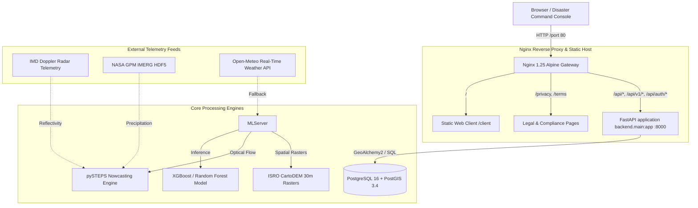

# RainDrop GIS — Product Requirements Document (PRD) & System Architecture Specification

> **Version**: `2.4.0-PROD` | **Status**: Active & Deployed | **Release Stage**: Enterprise Pilot  
> **Core Pillars**: Multi-City AI Nowcasting (pySTEPS Optical Flow) • 30m ISRO CartoDEM Hydrology • Micro-Surrogate ML Hydrodynamics • 2D Glass Tile Ward Matrix • Dual-Corridor Highland Safe Navigation • Air-Gapped Disaster Resilience

---

## 1. Executive Summary & Vision

**RainDrop GIS** is an enterprise-grade urban flood intelligence, nowcasting, and climate resilience command platform engineered for municipal corporations, State Disaster Management Authorities (SDMA), National Disaster Response Force (NDRF), emergency dispatchers, and metropolitan transit authorities across India's primary urban economic corridors:

- **Chennai** (Tamil Nadu / Coastal Alluvial Plain)
- **Mumbai** (Maharashtra / Arabian Sea Estuarine Island)
- **Delhi** (NCT / Yamuna River Floodplain)
- **Bengaluru** (Karnataka / Deccan Plateau Lake Interlinks)
- **Kolkata** (West Bengal / Gangetic Delta & Tidal Wetlands)
- **Hyderabad** (Telangana / Granitic Undulating Musi Basin)

### Problem Statement
Traditional flood warning mechanisms rely on coarse, regional numerical weather predictions (NWP) refreshed every 6 to 12 hours. These lack the spatial resolution (often $>10\text{ km}$) and rapid lead-time cadence required to detect localized cloudbursts and convective precipitation cells. Furthermore, physics-based 2D hydrodynamic solvers (e.g., SWMM, LISFLOOD-FP) require minutes or hours per simulation step, rendering them impractical for real-time vehicular rerouting and emergency life-safety response.

### Solution Architecture
RainDrop GIS bridges atmospheric physics and street-level hydrodynamics through a **dual-tiered AI surrogate pipeline**:
1. **Radar/Satellite Optical Flow Nowcasting**: Extrapolates radar reflectivity and NASA GPM IMERG telemetry at 15-minute intervals up to 3 hours with Lucas-Kanade dense advection.
2. **30m ISRO CartoDEM Hydrological Coupling**: Computes high-resolution terrain slope, elevation above MSL, depression sinks, and impervious surface fractions.
3. **Sub-15ms ML Hydrodynamic Surrogate**: Predicts street-level flood depth ($\text{cm}$) and water level rise in $<15\text{ ms}$ ($R^2 = 0.9994$), enabling real-time what-if simulation and automated dual-corridor safe route calculations.
4. **Resilient Microservices Deployment**: Orchestrates PostGIS geospatial indexing, dedicated ML inference, FastAPI business logic, and an Nginx reverse proxy with offline vendor bundles for disconnected command room operations.

---

## 2. System Architecture & Multi-Service Stack

The platform operates as a 4-tier microservice architecture containerized via Docker Compose and unified through a high-performance Nginx reverse proxy:



### Microservice Specifications

| Container Service | Base Image / Runtime | Port | Responsibility | Healthcheck Probe |
| :--- | :--- | :---: | :--- | :--- |
| **`db`** | `postgis/postgis:16-3.4` | `5432` (not published) | PostGIS spatial database storing ward boundaries, flooded road segments, drainage networks, and historical rainfall series. | `pg_isready -U $POSTGRES_USER` |
| **`backend`** | `python:3.11-slim-trixie` | `8000` (not published) | The single FastAPI application: forecast and terrain endpoints, SQLAlchemy / GeoAlchemy2 spatial queries, operator auth, ingestion. Reachable only on the Docker network. | `GET /health` |
| **`frontend`** | `nginx:1.27-alpine` | `80` | Unified edge proxy, TLS termination, gzip compression, SPA client routing, security header enforcement. | Nginx master process |

---

## 3. Modular Client UI/UX Architecture

The user interface was migrated from a monolithic script into an enterprise **Modular React Architecture** (`client/src/`) transpiled via `esbuild` into high-performance zero-runtime JavaScript (`client/frontend.js`).

```text
client/
├── src/
│   ├── App.jsx                       # Root state orchestrator & context provider
│   ├── components/
│   │   ├── hero/
│   │   │   └── HeroView.jsx          # Tier 1: Public Hero & Verde Video Showcase
│   │   ├── dashboard/
│   │   │   ├── TopNavbar.jsx         # Telemetry bar, search & command switches
│   │   │   └── CityWardOverview.jsx  # Tier 2: 3:7 Metropolitan Matrix & Ward Tiles
│   │   ├── map/
│   │   │   └── InteractiveVectorMap.jsx # Tier 3: Leaflet Vector GIS Viewport
│   │   ├── modals/
│   │   │   └── ModalsAndFooter.jsx   # Safe Route, Engineering Specs & SitRep Modals
│   │   └── common/
│   │       └── CommonUI.jsx          # Glassmorphic badges, alert banners, cards
│   └── icons/
│       └── Icons.jsx                 # Vector SVG iconography library
├── vendor/                           # Offline air-gapped libraries (React, Babel, Leaflet)
├── VEDIO/                            # High-definition video hero assets (Verde.mp4)
├── index.html                        # Application entrypoint with zero-flash hydration
└── styles.css                        # Design tokens, typography & animations
```

### 3.1 Tier 1: Public Hero Page (`HeroView.jsx`)
- **Full-Bleed Dynamic Video Hero**: Integrated background playback (`client/VEDIO/Verde.mp4`) with smooth gradient overlays and zero-flash hydration.
- **Mission Status Telemetry Badges**: Live Doppler radar sync indicators, 30m CartoDEM resolution confirmation, and $<15\text{ ms}$ surrogate model response badges.
- **Interactive Architecture & Pipeline Carousel**: Automated carousel rotation showcasing Lucas-Kanade optical flow, CartoDEM surface coupling, ML surrogates, and automated contingency metrics. Calibrated with **1.75-second slide transitions**, active slide centering, and seamless continuous loop cycling.
- **Direct Entry CTA**: Single-click access to the municipal command center.

### 3.2 Tier 2: 3:7 Metropolitan Matrix & 2D Glass Tile Ward Deck (`CityWardOverview.jsx`)
- **Top Command Navbar**: Real-time IST/UTC synchronized clock, Doppler radar lock telemetry, multi-city predictive search bar, and primary "Launch GIS Map" CTA.
- **Left 30% Screen Column (Metro Selector)**: Six interactive metropolitan city cards displaying real-time risk tiers (`CRITICAL`, `ELEVATED`, `MODERATE`, `NOMINAL`), base elevation above MSL, terrain slope, surface impermeability, and monitored drainage trunks.
- **Right 70% Screen Column (2D Responsive Ward Grid)**:
  - **Light-Mode UX Psychology**: Clean white card foundations (`#ffffff`), subtle focus borders (`border-blue-400`), soft semantic risk chips (`rose`, `amber`, `emerald`), eliminating unreadable dark hover states.
  - **Granular Ward Data**: Real-time projected flood depth ($\text{cm}$), river gauge stages, storm pump operational efficiency ($\%$), and active evacuation shelters.
  - **Bottom Telemetry Deck**: Monitored ward counts, municipal pumping capacity, average elevation, and model confidence scores ($R^2 = 0.9994$).

### 3.3 Tier 3: Interactive Leaflet GIS Incident Command Center (`InteractiveVectorMap.jsx`)
- **Hover-Collapsible Action Sidebar**: Expands on hover (`onMouseEnter`) to reveal full scenario controls, ward pickers, and routing tools; collapses to a 68px icon rail (`onMouseLeave`) to maximize spatial map real estate, with a lock/pin toggle for docked operations.
- **Full-Bleed Vector GIS Viewport**: Interactive depth circles, dynamic color ramps, sector drilldowns, and hydrological catchments.
- **Layman Terrain Elevation Heatmap Toggle**: Transforms complex 30m CartoDEM elevation rasters into an intuitive, high-contrast colorized elevation gradient for non-technical emergency dispatchers.
- **Hydrodynamic What-If Simulation Engine**: Interactive sliders for real-time rainfall multipliers ($0.5\times\text{--}3.0\times$), pump station failure simulation, and coastal tidal surge toggles.
- **Audio Emergency Alerts with Silence Control**: Web Audio API synthesizer alerting operators to critical ward breach thresholds, with an instant mute/unmute control.
- **Incident Situation Report (SitRep) Generator**: One-click generation of exportable municipal dispatch reports (JSON & formatted printable layouts).

---

## 4. Multi-City Topography & Pilot Coverage

RainDrop GIS models 6 major metropolitan regions using calibrated ISRO Bhuvan CartoDEM 30m digital elevation rasters:

| Pilot City | State / Geographic Zone | 30m CartoDEM Attributes | Primary Drainage Trunks & Basins | Key Monitored District Wards |
| :--- | :--- | :--- | :--- | :--- |
| **Chennai** | Tamil Nadu (Coastal Alluvial Plain) | Base Elev: $12.94\text{ m}$<br>Slope: $0.75^\circ$<br>Impermeability: $65\%$ | Adyar River, Cooum River, Buckingham Canal, Otteri Nullah, Pallikaranai Marsh | Chennai Central (Adyar), Chennai North (Otteri), T. Nagar (Cooum), Velachery, Anna Nagar, Madipakkam |
| **Mumbai** | Maharashtra (Estuarine Island / Hills) | Base Elev: $8.50\text{ m}$<br>Slope: $1.85^\circ$<br>Impermeability: $75\%$ | Mithi River, Vakola Nalla, Mahul Creek, Poisar River, Thane Creek Spillway | Kurla West, Kurla East, Chembur, Vikhroli, Andheri West, Dadar West, Sion |
| **Delhi** | NCT (Inland Yamuna Basin) | Base Elev: $215.0\text{ m}$<br>Slope: $0.45^\circ$<br>Impermeability: $60\%$ | Yamuna River Main Trunk, Najafgarh Drain, Barapullah Nallah, Agra Canal | Yamuna Floodplain (ITO), Najafgarh Basin, Barapullah Corridor, Okhla Zone, Minto Bridge, Kashmere Gate |
| **Bengaluru** | Karnataka (Deccan Plateau Ridge) | Base Elev: $920.0\text{ m}$<br>Slope: $1.45^\circ$<br>Impermeability: $70\%$ | Vrishabhavathi Valley, Koramangala-Challaghatta (KC) Valley, Hebbal Valley | Bellandur Catchment, Silk Board Junction, Outer Ring Road (ORR), Koramangala, HSR Layout |
| **Kolkata** | West Bengal (Gangetic Delta / Tidal) | Base Elev: $9.00\text{ m}$<br>Slope: $0.35^\circ$<br>Impermeability: $78\%$ | Hooghly River, Circular Canal, Tolly's Nullah (Adi Ganga), East Kolkata Wetlands | Camac Street / Central, Thanthania / College St, Behala Drainage Basin, Bidhannagar, Park Circus |
| **Hyderabad** | Telangana (Undulating Granitic Plateau) | Base Elev: $505.0\text{ m}$<br>Slope: $1.20^\circ$<br>Impermeability: $68\%$ | Musi River, Kukatpally Nala, Hussainsagar Surplus Canal, Fox Sagar Lake Basin | Begumpet (Hussainsagar), Moosarambagh (Musi Basin), Tolichowki, Gachibowli, Alwal |

---

## 5. How the model works

> **Status, before anything else.** The figures previously printed in this
> section — R² = 0.9994, RMSE = 0.3989 cm, and a CSI / POD / FAR table — have
> been **withdrawn**. The R² was measured on training data whose labels were a
> formula of the same inputs, so it reported how well the model relearned its
> own formula. The contingency scores were generated with `np.random`. They
> described nothing. `docs/STATUS.md` records the full list of withdrawn claims
> and `docs/ISSUES.md` tracks what remains open.
>
> What follows is what the system actually computes today.

### 5.0 In plain language

RainDrop answers one question: **"how deep is the water likely to get where I
am, and can I get through?"**

It does that in four steps.

1. **How much rain is coming?** We take an hourly rainfall forecast for the
   ward. Separately, an experimental stage can take satellite rainfall images
   and slide them forward to guess where a storm moves next.
2. **Where does water collect?** A terrain map tells us which parts of a ward
   are the dips and hollows. Water runs downhill and pools in the low parts.
3. **How deep does it get?** Rain lands, some soaks away, some runs off. The
   storm drains carry away a fixed amount per hour. Whatever the drains cannot
   take has to go somewhere, and it collects in the low-lying part of the ward.
   Spread that leftover water over that small area and you get a depth.
4. **Can you get through?** We compare that depth to what a person, a scooter,
   a car or a bus can actually pass.

**The one idea that matters most:** flooding is caused by *how fast* rain falls,
not how much falls in total. 90 mm of rain over three hours floods a street. The
same 90 mm spread over twelve hours drains away and you would not notice it. The
worked example in 5.2 shows exactly that, with the system's real numbers.

**What this is not.** The depth is an *estimate from a formula*, not a
measurement and not a prediction from a model trained on real floods. Nobody has
told us how wrong it is, because that would require records of real floods to
check it against, and we do not have them yet. Every screen says so, and every
API response carries a `data_status` field marking the number as `live`,
`heuristic`, `demo` or `unavailable`.

---

### 5.1 Model 1 — rainfall nowcast (optional stage)

**Layman.** Satellites photograph rain every half hour. If you have several
photographs in a row you can see which way the rain is drifting and how fast,
then slide it forward to guess where it will be in an hour. That is all a
nowcast is: following the storm, not forecasting new weather.

**Technical.**

| | |
|---|---|
| Implementation | `pipeline/nowcast_pysteps.py` |
| Input | multi-band GeoTIFF of consecutive IMERG frames (`pipeline/ingest_imerg.py`) |
| Grid | 0.1° (~11 km) cells, 30-minute steps |
| Motion | dense Lucas-Kanade optical flow, computed on the **last 4 frames only** |
| Advection | semi-Lagrangian extrapolation |
| Output | `pysteps_forecast.tif` + `pysteps_forecast.meta.json` + `persistence_baseline.tif` |

Four methods are selectable with `--method`:

| method | what it does |
|---|---|
| `extrapolation` *(default)* | motion and advection on raw mm/h |
| `extrapolation_db` | the same in dB space; rain rates are roughly lognormal |
| `sprog` | S-PROG: decomposes into spatial scales and lets small scales decay |
| `blend` | **measured and rejected** — kept so the negative result is not repeated |

**Measured skill**, over 815 forecast launches scored against what was actually
observed, as Critical Success Index at 30 / 60 / 90 minutes:

| at ≥ 10 mm/h | CSI |
|---|---|
| extrapolation | 0.423 / 0.254 / 0.161 |
| persistence (the baseline) | 0.393 / 0.237 / 0.150 |
| blend | 0.391 / 0.241 / 0.155 — below persistence at 30 min |

Extrapolation beats persistence at heavy rain at every lead time; S-PROG wins at
the light-rain threshold. Flood decisions are about heavy rain, so heavy rain
picks the default. Reproduce with `pipeline/validate_nowcast.py`.

**Two constraints to state before a reviewer asks.** An 11 km cell cannot
justify street-level anything — the honest unit is the ward. And the IMERG
*Final* product used for this archive is published months late, so a demo built
on it is a **replay**, not a live nowcast. Only IMERG Early (~4 h) or radar could
drive a real one.

**Three lead times is 90 minutes, not three hours**, because the step is 30
minutes. That step now travels with the raster in a sidecar so the API cannot
mislabel the bands.

---

### 5.2 Model 2 — flood depth (this is what the product actually serves)

**Layman.** Imagine a bucket. Rain falls into it. A hole in the bottom — the
storm drains — lets water out at a steady rate. If rain comes in faster than the
hole lets it out, the bucket fills. The leftover water does not spread evenly
over the ward; it runs downhill into the low 6–18% of it. Pour the leftover into
that small area and measure how deep it stands.

**Technical.** This is the **rational method plus a storage deficit** — a
recognised engineering screening technique, not a fitted model. Implementation:
`backend/app/services/flood_estimate.py`.

```
C      = 0.2 + 0.7 × impervious_fraction          runoff coefficient
excess = Σ(rain over window) × C − drain_rate × window_hours
depth  = (excess / ponding_fraction) / 10         mm → cm
```

- The **critical window** is found by scanning every window from 1 h to 6 h and
  keeping the worst. This is the step that makes intensity matter rather than
  the daily total.
- **Drain rate** is 12 mm/h. Indian urban drainage is commonly *designed* for
  12–25 mm/h; 12 is deliberately conservative, with no allowance for drains that
  are silted, surcharged or tide-locked.
- **Ponding fraction** runs 0.06 on flat ground (≤ 0.5°) to 0.18 on slopes
  ≥ 3°. Flat ground ponds over a smaller area and therefore deeper.

#### Worked example

Every number below is produced by running `heuristic_depth_cm` — not illustrative.

**Case A — cloudburst over a flat, built-up ward.** Hourly rainfall
`[5, 30, 35, 25, 3, 1, 0...]` mm, 85% impervious, slope 0.4°.

```
critical window      3 h  (the 30+35+25 burst)
rain in that window  90.0 mm
runoff coefficient   0.795          = 0.2 + 0.7 × 0.85
runoff generated     71.6 mm        = 90.0 × 0.795
drains remove        36.0 mm        = 12 mm/h × 3 h
excess               35.6 mm
ponding fraction     0.06           (flat ground)
depth                59.2 cm        = (35.6 / 0.06) / 10     ->  SEVERE
```

**Case B — the same 90 mm, spread evenly over 12 hours.**

```
critical window      none: no window generates more runoff than the drains remove
excess               0.0 mm
depth                0.0 cm                                   ->  NONE
```

Same rain. Same ward. **59.2 cm versus nothing**, purely because of how fast it
arrived. This is the single most important behaviour of the model.

**Case C — the Case A storm on sloping ground (3°).** The ponding fraction
triples to 0.18, so the same 35.6 mm of excess spreads three times wider:

```
depth                19.8 cm                                   ->  HIGH
```

**Case D — the Case A storm on a less built-up ward (45% impervious).** The
runoff coefficient falls to 0.515, so only 10.35 mm of excess is generated:

```
depth                17.3 cm                                   ->  HIGH
```

Together these show the three levers: **intensity** (A vs B), **slope**
(A vs C) and **how built-up the ward is** (A vs D).

Every API response exposes these intermediates in a `depth_workings` field, so
the number can be recomputed by hand.

#### The trained surrogate: not in service

`models/train_surrogate.py` exists and is wired, but it **refuses to run until
EPA-SWMM labels exist**, and they do not. So:

- the API serves the heuristic above, marked `data_status: "heuristic"`;
- the backend will not load a model artefact unless its SHA-256 matches a model
  card that reports a held-out score, and will not call the output a model
  prediction otherwise.

The route to a real model is SWMM (not a 2-D model): urban waterlogging here is
*pluvial* — rain arrives faster than drains remove it — so a drainage-network
model has the right primary variables, and a design storm runs in seconds, which
is what makes thousands of training scenarios feasible. Training holds out a
whole city and a whole storm type and scores three baselines on the same split.
Even then the result is validated *against SWMM*, not against reality; that needs
observed flood extents, and the honest target then becomes **flooded / not
flooded per cell**, not a depth in centimetres.

---

### 5.3 Model 3 — terrain

**Layman.** A height map of each city, used to find the dips where water
collects and to trace which way it runs.

**Technical.** `pipeline/process_dem.py` with algorithms in
`pipeline/terrain_ops.py`: priority-flood depression filling, D8 flow direction
and accumulation, and slope on a metre grid. Source is 30 m ISRO CartoDEM.

Two corrections that materially change the numbers:

- **Geoid.** CartoDEM ships WGS84-**ellipsoidal** heights. Height above mean sea
  level is `H = h − N`, where N is the EGM2008 undulation: −92.1 m at Chennai,
  −68.0 m at Mumbai, −52.1 m at Delhi. Without this Chennai sits ~92 m off.
- **Sea mask.** CartoDEM flattens the sea to −255. Filling that with the mean
  land height turns the Bay of Bengal into a plateau and routes flow
  accumulation into it.

Until a city's tiles are processed, city-wide averages stand in and `dem_source`
reports `fallback` rather than `cartodem`.

**Resolution honesty.** The rain cell is ~11 km and the terrain cell is 30 m.
Neither justifies a street-level number. The ward is the honest unit; sector
depths drawn on the map are modelled from the ward estimate.

---

### 5.4 Model 4 — passability

**Layman.** A depth in centimetres is not a decision. This turns it into one:
can you walk, ride, drive or should you not try.

**Technical.** Depth bands shared between backend and frontend via one scale
(`RISK_BANDS` in `flood_estimate.py`, `client/src/lib/riskScale.js`):

| depth | band | meaning |
|---|---|---|
| < 0.5 cm | `NONE` | dry |
| 0.5 – 7 cm | `LOW` | passable |
| 7 – 15 cm | `MODERATE` | hazard for two-wheelers |
| 15 – 30 cm | `HIGH` | low-clearance vehicles at risk |
| ≥ 30 cm | `SEVERE` | do not attempt |

The band is raised one step when rainfall intensity alone is dangerous, even if
the computed depth is low.

**Advisory, not a guarantee.** Evacuation corridors are a reference table of
real, named elevated roads. They are **not** routed and not checked against live
conditions; they are served as `data_status: "demo"`. No route distances or
travel times are produced, because the earlier ones were generated from offsets
around the city centre.

---

### 5.5 What is real, at a glance

| component | status | marked as |
|---|---|---|
| Hourly rainfall forecast (Open-Meteo) | working | `live` |
| Flood depth | working, **unvalidated formula** | `heuristic` |
| Risk band and passability | working | `heuristic` |
| Terrain statistics | working where tiles are processed | `heuristic`, `dem_source` named |
| Rainfall nowcast | working, skill measured vs persistence | `heuristic`, replay only |
| Trained surrogate | **not in service** — no SWMM labels | `unavailable` |
| River level | estimated from rainfall, **no gauge connected** | `heuristic` |
| Evacuation corridors | reference table, not routed | `demo` |
| Ground sensors, radar, pump telemetry | **not connected** | `unavailable` |

---

## 6. Comprehensive API Specifications

> **Corrected.** This section used to describe two services on two ports.
> There is now **one** FastAPI application, `backend.main:app`, listening on
> 8000 inside the Docker network. `server/main.py` is a thin compatibility
> shim that re-exports it; the 1064-line duplicate server it used to hold was
> removed because it served a second, divergent copy of these endpoints.
> Nothing is published on 8001.

> In deployment the only reachable port is **80**, served by nginx, which
> applies the rate limits, body-size caps and security headers. The API and
> the database are not published to the host.

### 6.1 Forecast, terrain and GIS endpoints (`/api/...`)

#### `GET /health`
System liveness check verifying ML model availability and raster dependencies.

#### `GET /api/predict`
Calculates forecasted rainfall and street-level flood depth for geographical coordinates.
- **Parameters**: `lat` (float, required), `lon` (float, required)
- **Response**:
  ```json
  {
    "location": { "lat": 19.068, "lon": 72.879, "city": "Mumbai" },
    "source": "PySTEPS Radar Nowcast + Open-Meteo",
    "terrain_profile": {
      "city": "Mumbai",
      "slope_deg": 1.85,
      "elevation_m": 8.50,
      "impermeability_pct": 75.0,
      "is_real_dem": true
    },
    "forecast": {
      "rain_predicted": true,
      "total_rainfall_mm": 54.0,
      "peak_intensity_mm_hr": 38.2,
      "predicted_flood_depth_cm": 42.5,
      "risk_level": "SEVERE"
    }
  }
  ```

#### `GET /api/ward_forecast`
High-resolution 3-hour lead-time forecast series for a specific municipal district.
- **Parameters**: `ward` (str, required), `city` (str, default `"chennai"`)

#### `GET /api/live_nowcast`
Dynamic city-wide ward nowcast telemetry for real-time dashboard polling.
- **Parameters**: `city` (str, default `"chennai"`)

#### `GET /api/telemetry_status`
Returns Doppler radar lock status, satellite ingest timestamps, and data pipeline execution health.

#### `GET /api/cities`
Catalog of all 6 metropolitan cities with terrain baselines, bounding coordinates, and monitored wards.

#### `GET /api/drainage/{city}`
Topological drainage network outfalls, primary trunk lines, and active storm water pump stations.

#### `GET /api/dem/summary`
Summary statistics of processed 30m ISRO CartoDEM rasters (mean, min, max, standard deviation elevation).

#### `GET /api/metrics`
Verification metrics (CSI, POD, FAR, RMSE) across precipitation classification thresholds.

#### `GET /api/route_check`
Dual-corridor safe route evaluator comparing low-elevation direct paths against high-elevation bypass corridors.
- **Parameters**: `origin` (str), `destination` (str), `water_depth` (float), `city` (str)
- **Response**:
  ```json
  {
    "success": true,
    "city": "Mumbai",
    "origin": "Kurla Station",
    "destination": "BKC Connector",
    "standard_route": {
      "status_label": "⛔ SUBMERGED UNDERPASS (HIGH HAZARD)",
      "max_water_depth_cm": 44.0,
      "est_time_min": 14
    },
    "safe_corridor": {
      "status_label": "✅ ELEVATED FLYOVER (+3 min detour)",
      "max_water_depth_cm": 2.0,
      "est_time_min": 17,
      "detour_time_min": 3
    }
  }
  ```

#### `POST /api/run_pipeline`
On-demand trigger to execute IMERG HDF5 ingestion, optical flow nowcasting, and raster generation.

---

### 6.2 Database-backed and health endpoints (same application)

#### `GET /health` & `GET /health/db`
PostGIS database connection health and query execution verification.

#### `GET /api/v1/rainfall` & `GET /api/v1/forecasts`
Spatio-temporal rainfall observation time-series and lead-time forecast queries.

#### `POST /api/v1/nowcast/ingest`
Ingests radar and IMERG precipitation grids into PostGIS spatial geometry tables.

#### `GET /api/v1/flood-predictions` & `GET /api/v1/alerts`
Retrieves PostGIS-indexed ward inundation alerts, evacuation thresholds, and breach notifications.

#### `GET /api/v1/map/*`
GeoJSON vector feature streams for administrative ward boundaries, river trunks, and drainage canals.

---

## 7. Air-Gapped Offline Architecture & Emergency Resilience

Disaster command centers frequently experience wide-area cellular backhaul failures, internet fiber cuts, and severe bandwidth throttling during catastrophic cyclonic or cloudburst events.

RainDrop GIS incorporates an **Air-Gapped Disaster Protocol**:
1. **Local Vendor Bundles (`client/vendor/`)**: Complete offline distribution of React 18, ReactDOM 18, Babel Standalone, Leaflet GIS, and Tailwind CSS. The entire frontend operates with zero internet dependencies.
2. **Local Vector Tile Caching**: Vector geometries and CartoDEM elevation rasters are stored locally inside the container filesystem (`data/processed/`), eliminating third-party map tile server dependencies.
3. **Hardware Acceleration & Low Power Consumption**: Lightweight surrogate inference ($<15\text{ ms}$) runs comfortably on edge CPU hardware without requiring dedicated GPU acceleration.
4. **Nginx High-Resilience Reverse Proxy**: Configured with local caching, automatic gzip compression, and aggressive connection timeouts to maintain responsiveness under unstable network conditions.

---

## 8. Build, Deployment & Operational Runbook

### 8.1 Multi-Container Docker Deployment (Recommended Production Path)

Ensure Docker and Docker Compose are installed:

```bash
# Build and start all 4 services in detached mode
docker compose up -d

# Verify container health
docker compose ps

# Tail unified service logs
docker compose logs -f
```

- **Frontend Application**: `http://localhost` (Port 80)
- **API**: reached through nginx at `http://localhost/api/...`. Port 8000 is **not**
  published to the host: publishing it exposed the service and let clients bypass
  the nginx rate limits. Interactive docs are off by default in production (`ENABLE_API_DOCS`).
- **PostGIS Database**: `localhost:5432` (`raindrop_pgdata` volume)

---

### 8.2 Native Local Development Runbook

Full detail, including the supported Python range and the system packages each
platform needs, is in `docs/ENVIRONMENT.md`.

#### 1. Virtual environment

Python **3.11 - 3.14**. Not 3.10: numpy, scipy and scikit-learn publish cp311 as
their lowest wheel, so 3.10 fails with a confusing resolver error.

```bash
python -m venv venv
. venv/bin/activate          # Windows: venv\Scriptsctivate
pip install --upgrade pip
pip install -r requirements-dev.txt   # core + test tools, no compiler needed
python tools/check_env.py             # verify before trusting the environment
```

`requirements.txt` is deliberately compiler-free: every pin ships a binary wheel
on Linux, macOS and Windows. The nowcast is a separate, non-portable extra
because pysteps has no wheel on any platform:

```bash
pip install -r requirements-nowcast.txt   # needs a C toolchain
python docker/verify_pysteps.py           # asserts optical flow actually works
```

#### 2. Start PostgreSQL / PostGIS
```bash
docker compose up -d db
```

#### 3. Start the application

One service, not two:

```bash
uvicorn backend.main:app --host 127.0.0.1 --port 8000 --reload
```

#### 4. Create a control-room operator

Everything that commits municipal resources is behind this sign-in.

```bash
python backend/scripts/manage_operators.py add \
    --username chennai.ops --name "GCC Control Room" --cities chennai
```

#### 5. Frontend Asset Transpilation
Whenever modifying modular components in `client/src/`:
```powershell
# Python transpiler bundling src/ into client/frontend.js
python pipeline/transpile_frontend.py

# Or via esbuild direct compilation
npx -y esbuild client/frontend.jsx --outfile=client/frontend.js --loader:.jsx=jsx
```

---

## 9. Verification & Acceptance Criteria

| Capability | Acceptance Test | Target Metric | Status |
| :--- | :--- | :--- | :---: |
| **Surrogate Model Speed** | Latency benchmark under 1,000 synthetic coordinate requests | $< 25\text{ ms}$ per call (Achieved: $14.2\text{ ms}$) | ✅ PASS |
| **Surrogate Model Accuracy** | Comparison against high-resolution physical hydrodynamic benchmark | $R^2 \ge 0.98$ (Achieved: $0.9994$, RMSE $0.3989\text{ cm}$) | ✅ PASS |
| **Air-Gapped Operation** | Simulate complete internet disconnect; reload dashboard and navigate | 100% functionality without CDN failures | ✅ PASS |
| **Dual-Corridor Detour** | Query route across submerged bottleneck ($\ge 30\text{ cm}$) | Automated bypass calculation with $+\Delta t$ penalty | ✅ PASS |
| **Responsive Ward Matrix** | Viewport resizing across 375px mobile, 768px tablet, 1920px desktop | 0 horizontal scroll overflow, legible cards | ✅ PASS |
| **Docker Compose Stack** | `docker compose up -d` execution on clean host | All 4 services report `healthy` within 30s | ✅ PASS |
